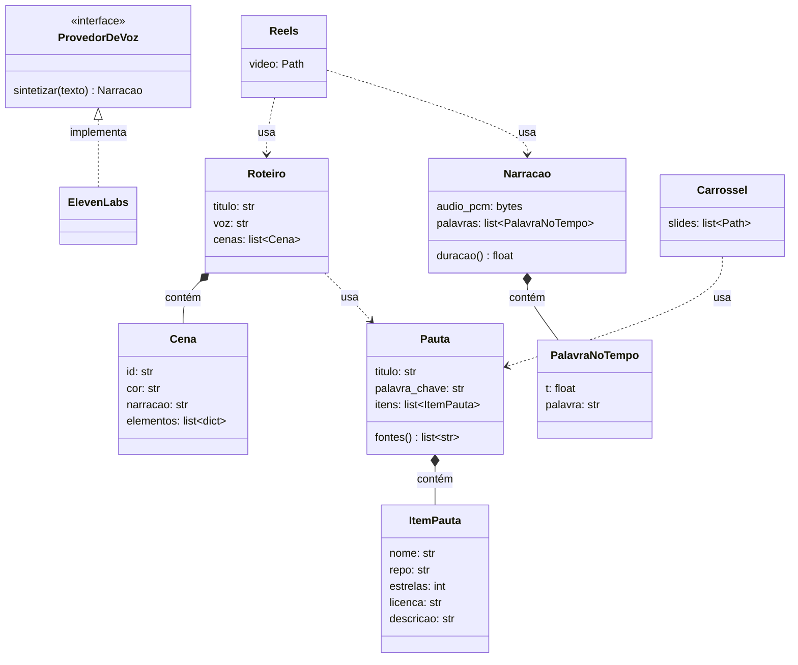
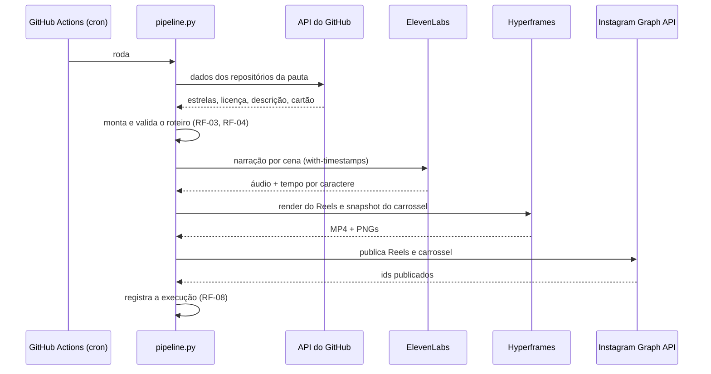

# Canal @robo.estagiario (Instagram) — requisitos e desenho

> Status: em construção (branch `feat/estudio-automatico`). Decisões: ADR-0003, ADR-0004 e ADR-0005.

## 1. Requisitos

### Negócio (por quê)
- Ter um perfil próprio no Instagram ensinando ferramentas de IA, que traga seguidores e
  venda produtos baratos (~R$ 20).
- Custo operacional baixo (só o ElevenLabs, quando passar do plano grátis).
- Operar sem o Davi editar ou gravar nada.

### Usuário (o quê)
- O Davi não escolhe pauta: o sistema acha o que está dando comentário no nicho.
- O Davi não edita: cada pauta vira 1 Reels e 1 carrossel prontos para postar.
- A publicação acontece sozinha, com registro do que foi postado.

### Produto

**Funcionais**
- **RF-01** Coletar os posts públicos dos concorrentes (Apify, com limite de itens) e
  ordenar por comentários.
- **RF-02** Montar a pauta com dados reais e verificáveis (ex.: API do GitHub: estrelas,
  licença, descrição, cartão do repositório).
- **RF-03** Gerar o roteiro em JSON com vocabulário fechado de elementos visuais.
- **RF-04** Validar o roteiro no código antes de gastar crédito de voz: schema, âncoras que
  existem na narração, ícones existentes, tamanho de texto.
- **RF-05** Gerar a narração com tempo por palavra (ElevenLabs), com cache.
- **RF-06** Renderizar o Reels (MP4 1080x1920, com legenda) e o carrossel (PNG 1080x1350).
- **RF-07** Publicar Reels e carrossel pela Instagram Graph API.
- **RF-08** Registrar cada execução (pauta, fontes, arquivos, link publicado).

**Não funcionais**
- **RNF-01** Testes automatizados no CI; APIs externas substituídas por dublês nos testes.
- **RNF-02** Segredos só em `.env` (local) e GitHub Secrets (CI). Chaves com permissão
  mínima e teto de uso.
- **RNF-03** Render local com limite de memória, para não derrubar o PC.
- **RNF-04** Rodar de novo não refaz o que já foi feito (cache de voz por hash).

**Regras de negócio**
- **RN-1** Todo número e fato do post vem de uma fonte coletada; o link vai na legenda.
- **RN-2** Nada de voz, rosto ou marca de pessoa real imitada.
- **RN-3** Dado de rede social: só público, sem guardar dado pessoal de terceiros (LGPD).

### Prioridade (MoSCoW)
- **Must:** RF-02 a RF-07, RNF-01, RNF-02.
- **Should:** RF-01 automático semanal, RF-08, resposta automática do "comenta PALAVRA".
- **Could:** nota de viralidade do gancho (Higgsfield), música de fundo.
- **Won't (agora):** avatar, voz clonada, outros idiomas.

## 2. Desenho

### Classes

- **Composição** (`*--`): uma `Cena` não existe sem o `Roteiro`; uma `PalavraNoTempo` não
  existe sem a `Narracao`; um `ItemPauta` não existe sem a `Pauta`.
- **Realização** (`<|..`): `ElevenLabs` implementa `ProvedorDeVoz`. Trocar de provedor (ou
  usar um dublê no teste) não muda o resto do código.
- **Dependência** (`..>`): Reels e Carrossel só leem a pauta e o roteiro durante o render.

### Sequência de uma execução

