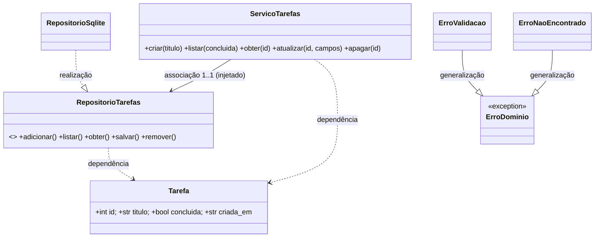
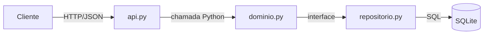
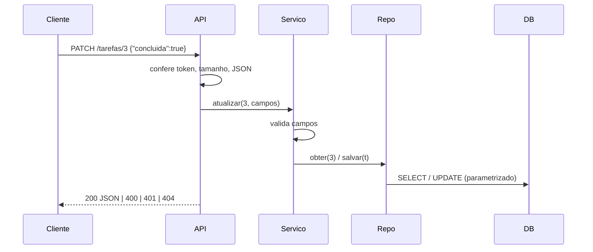

# Arquitetura

## Classes

Sem agregação/composição: Tarefa é entidade única, sem partes.

## Componentes

## Sequência: PATCH /tarefas/3

Estados e BPMN: N/A (tarefa só alterna concluída/pendente; não é processo de negócio).
